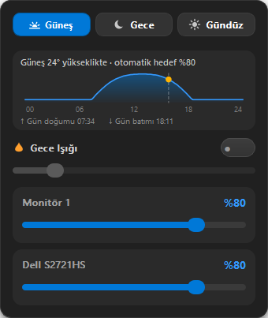

# ☀️ Windows Parlaklık Kontrolü (System Tray App)


Windows için çoklu monitör destekli, Windows 11 koyu temalı, **%100 çevrimdışı güneş yüksekliği (NOAA)** hesabıyla çalışan bir sistem tepsisi parlaklık kontrol uygulaması.

---

## 📸 Arayüz



---

## ✨ Özellikler

- 🌅 **Güneş Modu**: İnternet gerektirmez. Konumundaki güneş yüksekliğinden parlaklığı yumuşak bir sinüs eğrisiyle hesaplar ve dakikada bir günceller.
- 📈 **Güneş paneli**: Şu anki güneş yüksekliğini, otomatik hedef parlaklığı, gün doğumu/batımını ve bugünün parlaklık eğrisini (şimdiki anı gösteren işaretle) gösterir.
- 🌙 **Gece taban parlaklığı**: Otomatik ve Gece modunda ekran artık tamamen kararmaz. Alt sınır varsayılan %10, tepsi menüsünden (%0 / 5 / 10 / 15 / 20 / 30) değiştirilir.
- 💾 **Ayarlar hatırlanır**: Son mod, Gece Işığı durumu ve şiddeti, özel moddaki monitör değerleri yeniden başlatınca korunur.
- 🖥️ **Çoklu monitör ve sıcak takma**: Monitör takılıp çıkarıldığında arayüz yeniden kurulur, pencere içeriğe göre boyutlanır (1, 2, 3+ monitör).
- ⚡ **Arayüzü bekletmeyen donanım erişimi**: Monitör tarama (DDC/CI okuma) ve parlaklık yazma ayrı iş parçacıklarında yapılır. Popup açılırken arayüz donmaz, aynı monitör için art arda gelen yazmalar tek değere indirilir.
- 🔥 **Gece Işığı filtresi**: Windows API'lerine dokunmadan, tıklamaları geçiren, şiddeti ayarlanabilir turuncu bir katman çizer.
- 🎨 **Hazır profiller**: Güneş, Gece, Gündüz tek tıkla. Slider elle (fare, klavye ya da tekerlek) değiştirilince "Özel Mod" olur.
- 🔒 **Tekil çalışma**: Uygulama açıkken tekrar başlatılırsa mevcut pencere öne gelir.
- 📌 **Tepsi**: Fareyle üzerine gelince mod ve monitör parlaklıkları görünür. Ortadaki tuş Güneş Modu'nu açar. Simge yalnızca parlaklık ya da mod değişince yeniden çizilir (sürekli animasyon yok).
- 🔄 **Windows ile başlat**: Tepsi menüsünden `HKCU\...\Run` kaydı açılıp kapatılır.

---

## ⚙️ Ayar ve günlük dosyaları

Hepsi `%APPDATA%\ParlaklikKontrol\` altında:

| Dosya | Ne işe yarar |
| :--- | :--- |
| `settings.json` | Kalıcı ayarlar. Elle de düzenlenebilir (uygulama kapalıyken). |
| `app.log` | Hata ve olay günlüğü (256 KB'ta döner, `pythonw` altında konsol olmadığı için burada tutulur). |

`settings.json` anahtarları:

| Anahtar | Varsayılan | Açıklama |
| :--- | :--- | :--- |
| `lat`, `lon` | 39.6484, 27.8826 | Güneş hesabı için konum |
| `tz_offset` | `null` | `null` ise sistem saat dilimi kullanılır |
| `min_brightness` | 10 | Gece/otomatik modda en düşük parlaklık (%) |
| `mode` | `auto` | `auto`, `gece`, `gunduz`, `custom` |
| `night_light`, `night_light_strength` | `false`, 15 | Gece Işığı durumu ve şiddeti |
| `custom_values` | `{}` | Özel modda monitör başına parlaklık |

---

## 🛠️ Kurulum

```bash
pip install -r requirements.txt
```

## 🚀 Çalıştırma

```bash
pythonw brightness.pyw
```

> **Not:** "Windows ile Başlat" kaydı, betiğin ve Python'un tam yolunu saklar. Proje klasörünü taşırsan ya da Python'u başka bir dizine kurarsan menüden seçeneği kapatıp yeniden aç.

---

## 📄 Lisans

Bu proje **MIT Lisansı** altında serbestçe kullanılabilir ve geliştirilebilir.
